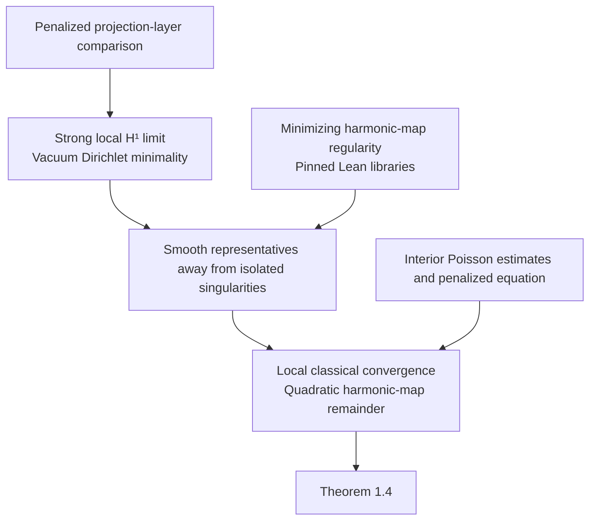
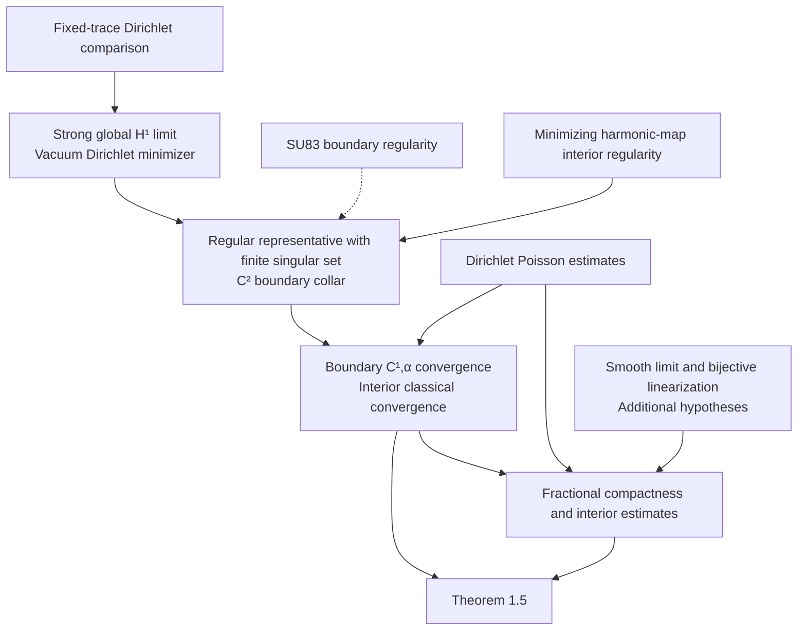
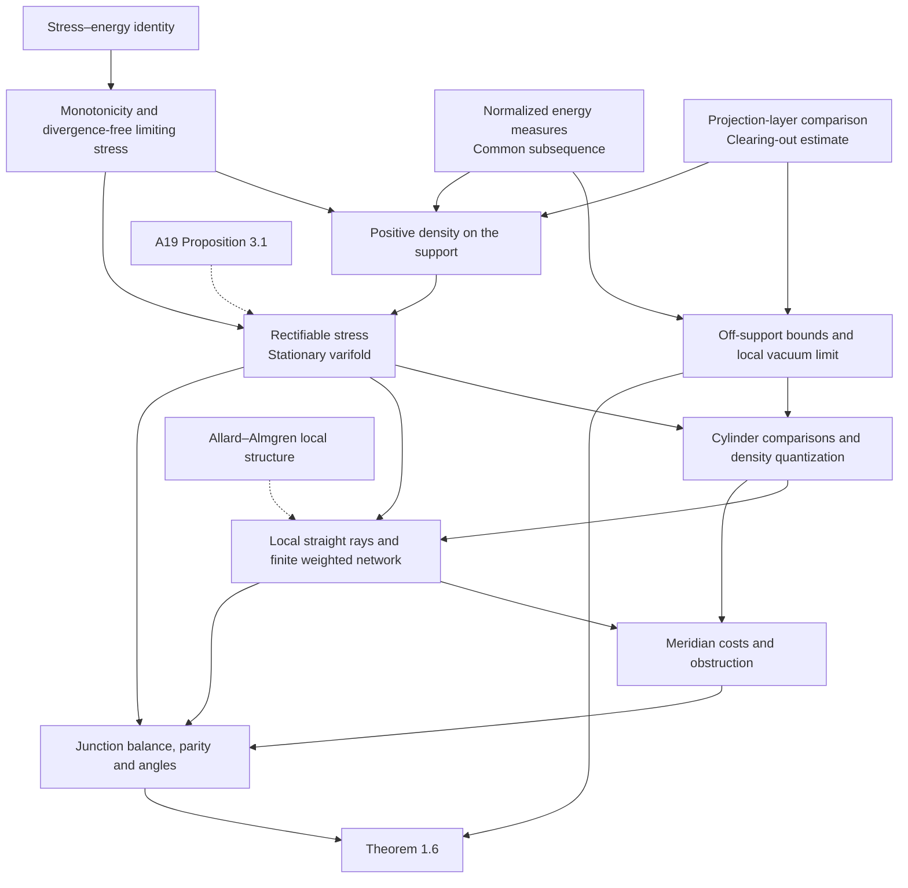

# Asymptotics of biaxial Landau–de Gennes minimizers in Lean 4

[](https://github.com/BrookWW/AsymptoticsBiaxialLdG/actions/workflows/build.yml)
[](https://github.com/BrookWW/AsymptoticsBiaxialLdG/actions/workflows/kernel.yml)

This repository formalizes **Theorems 1.4–1.6 of my doctoral thesis**,
*Landau–de Gennes Model with Sextic Potentials: Asymptotic Behavior of
Minimizers*. The [thesis excerpt](paper/thesis-excerpt.pdf) contains the
abstracts, introduction and original theorem statements.

The three results cover the bounded-energy limit, the fixed-trace limit with
its first correction, and the logarithmic-energy limit with line defects.
Theorem 1.4 has a complete Lean proof. Theorems 1.5 and 1.6 have complete
proofs relative to the explicit literature inputs listed below. Theorem
1.6(3) uses the off-support quantifiers detailed in its statement. The proof
terms use only Lean’s standard `propext`, `Classical.choice`, and
`Quot.sound` as axioms. [External inputs and dependency provenance](docs/external-inputs.md)

## What is proved

Let $`\mathcal S_0`$ be the real symmetric traceless $`3\times3`$ matrices
with the Frobenius norm. For positive bulk coefficients
$`a=(a_2,a_4,a_6,a'_6)`$, let $`r_*>0`$ satisfy
$`4a_6r_*^4+2a_4r_*^2=a_2`$. The nonnegative sextic potential $`f_b`$ has
vacuum manifold $`\mathcal N=f_b^{-1}(0)`$, the orbit of
$`\mathrm{diag}(r_*,-r_*,0)`$. Write $`t=\mathrm{tr}(Q^2)`$, $`s=\mathrm{tr}(Q^3)`$,
and $`t_*=2r_*^2`$. Put
$`P(t)=-a_2t/2+a_4t^2/4+a_6t^3/6`$.
For $`0<\varepsilon<1`$ the potential, energy density, and energy are

```math
\begin{gathered}
f_b(Q)=P(t)-P(t_*)+\tfrac{a'_6}{6}s^2, \\
e_\varepsilon(Q)=\tfrac12|\nabla Q|^2+\varepsilon^{-2}f_b(Q), \\
E_\varepsilon(Q;U)=\int_U e_\varepsilon(Q)\,dx.
\end{gathered}
```

In the statements below, local minimizers minimize on every ball compactly
contained in the domain among competitors with the same trace. The Lean
definitions carry the weak gradient along with the map through the energy,
minimality, and convergence statements. Put $`K_Q=Q^2-\tfrac23r_*^2 I`$. The vacuum harmonic-map equation has
ambient right-hand side

```math
\mathcal H(Q,\nabla Q)=-\tfrac{|\nabla Q|^2}{2r_*^2}Q-\tfrac{3\sum_j\mathrm{tr}((\partial_jQ)^2Q)}{r_*^4}K_Q.
```

[Bulk potential](Thesis/Model.lean#L69) · [Energy and minimality](Thesis/Definitions.lean#L83) · [Harmonic-map equation](Thesis/Definitions.lean#L116)

### Theorem 1.4 · Bounded energy

Fix $`a`$ and $`M>0`$. Let $`\Omega`$ be a bounded domain in $`\mathbb R^3`$ and
$`Q_\varepsilon`$ a family of local minimizers. Assume
$`E_\varepsilon(Q_\varepsilon;\Omega)\le M`$ and
$`\|Q_\varepsilon\|_{L^\infty(\Omega)}\le M`$ for every $`\varepsilon`$.
There is a sequence $`\varepsilon_n\to0`$ with the following properties.

1. $`Q_{\varepsilon_n}\to Q_0`$ strongly in $`H^1_{\mathrm{loc}}(\Omega)`$,
   with the weak gradients converging to $`\nabla Q_0`$.
   The scaled potential $`\varepsilon_n^{-2}f_b(Q_{\varepsilon_n})`$
   tends to zero in $`L^1_{\mathrm{loc}}(\Omega)`$. The limit belongs to
   $`H^1(\Omega;\mathcal N)`$, minimizes Dirichlet energy locally among
   vacuum-valued competitors with the same trace, and solves
   $`\Delta Q_0=\mathcal H(Q_0,\nabla Q_0)`$ weakly.
2. There is a locally finite set $`S\subset\Omega`$. The limit is smooth
   on $`\Omega\setminus S`$, and representatives $`Q_n^{\mathrm{reg}}`$
   equal to $`Q_{\varepsilon_n}`$ almost everywhere there converge to it
   in $`C^j_{\mathrm{loc}}(\Omega\setminus S)`$ for every $`j\ge0`$.
3. For each $`r>0`$ and $`\overline B_r(x)\subset\Omega\setminus S`$,
   every representative solves
   $`\Delta Q_n^{\mathrm{reg}}=\mathcal H(Q_n^{\mathrm{reg}},\nabla Q_n^{\mathrm{reg}})+R_n`$
   on $`B_{r/2}(x)`$. Put $`L=\|\nabla Q_0\|_{L^\infty(B_r(x))}`$.
   For every $`j\ge0`$, eventually along this sequence,
   $`\|\nabla^jR_n\|_{L^\infty(B_{r/2}(x))}\le C(j,r,L)\varepsilon_n^2`$,
   with the multi-index norm specified in Lean. The positive function
   $`C`$ is chosen from $`a`$ and $`M`$ before $`\Omega`$ and the minimizing
   family are specified.

[Complete Lean statement and proof](Thesis/Frozen/BoundedEnergyLimit.lean#L18)

### Theorem 1.5 · Fixed trace and first correction

Let $`\Omega`$ be a smooth bounded domain and let
$`Q_b=\mathrm{cover}_a(u_b)`$ for a smooth lift
$`u_b:\partial\Omega\to S^3`$ through the quaternion cover of $`\mathcal N`$.
For every $`\varepsilon`$, let $`Q_\varepsilon`$ be a global minimizer with
trace $`Q_b`$. With the SU83 boundary regularity input, there is a sequence
$`\varepsilon_n\to0`$ with the following properties.

1. $`Q_{\varepsilon_n}\to Q_0`$ strongly in $`H^1(\Omega)`$.
   The limit minimizes the Dirichlet energy among vacuum-valued maps
   with trace $`Q_b`$. Its singular set $`S`$ is finite.
2. Representatives $`Q_n^{\mathrm{reg}}`$ agree almost everywhere with
   $`Q_{\varepsilon_n}`$ on $`\Omega`$ and converge to $`Q_0`$ in
   $`C^{1,\alpha}_{\mathrm{loc}}(\overline\Omega\setminus S)`$
   for every $`0<\alpha<1`$ and in
   $`C^j_{\mathrm{loc}}(\Omega\setminus S)`$ for every integer $`j\ge2`$.
3. If $`Q_0`$ is smooth on $`\Omega`$ and the linearized Dirichlet operator
   $`H^1_0(\Omega;\mathcal S_0)\to H^{-1}(\Omega;\mathcal S_0)`$
   given by the weak linearization of $`\Delta Q-\mathcal H(Q,\nabla Q)`$
   with Frobenius pairing is bijective, there is a smooth $`Q_1`$ on $`\Omega`$. On the same selected sequence,
   $`\varepsilon_n^{-2}(Q_n^{\mathrm{reg}}-Q_0)`$ converges to $`Q_1`$ in
   $`H^s(\Omega)`$ for every $`0<s<1/2`$ and in $`C^j_{\mathrm{loc}}(\Omega)`$
   for every integer $`j\ge2`$.

For the pointwise identities of the correction, write $`q=Q_0`$, $`p=Q_1`$,
$`K_q=q^2-\tfrac23r_*^2 I`$, $`t_1=\mathrm{tr}(qp)`$ and
$`t_2=\mathrm{tr}(q^2p)`$. The normal component $`N`$ and tangent
component $`T`$ are given by

```math
\begin{aligned}
&t_1=-\frac{|\nabla q|^2}{4r_*^2(a_4+4a_6r_*^2)}, \\
&t_2=-\frac{\sum_j\mathrm{tr}((\partial_jq)^2q)}{a'_6r_*^4}, \\
&N=\frac{t_1}{2r_*^2}q+\frac{3t_2}{2r_*^4}K_q,\quad T=p-N.
\end{aligned}
```

Put $`g_1=\sum_j\mathrm{tr}(\partial_jT\,\partial_jq)`$,
$`g_2=\sum_j\mathrm{tr}(\partial_jT\,\partial_j(q^2))`$, and
$`h=\mathrm{tr}(T\Delta(q^2))`$. With
$`P_q^\top`$ the projection onto $`T_q\mathcal N`$, write
$`\mathrm{tf}(B)=B-\tfrac13\mathrm{tr}(B)I`$ for the trace-free part.
The tangential equation is

```math
\begin{aligned}
&\Delta T=-\frac{g_1}{r_*^2}q-\frac{3(2g_2+h)}{2r_*^4}K_q \\
 &\quad+(2a_4+8a_6r_*^2)t_1 T-P_q^\top\Delta N \\
 &\quad+3a'_6t_2\bigl[\mathrm{tf}(qp+pq)-\tfrac{t_2q+t_1K_q}{r_*^2}\bigr].
\end{aligned}
```

[Complete Lean statement](Thesis/Providers/GlobalEnergyLimitAndCorrection.lean#L154) · [Correction operators](Thesis/Definitions.lean#L225)

### Theorem 1.6 · Logarithmic energy and line defects

Fix $`a`$ and $`M>0`$. Let $`\Omega`$ be a bounded domain in $`\mathbb R^3`$
and $`Q_\varepsilon`$ a family of local minimizers with
$`E_\varepsilon(Q_\varepsilon;\Omega)\le M(\log(1/\varepsilon)+1)`$ and
$`\|Q_\varepsilon\|_{L^\infty(\Omega)}\le M`$ for every $`\varepsilon`$.
With A19 and Allard–Almgren as inputs, there is one sequence
$`\varepsilon_n\to0`$ satisfying all of the following conclusions.
Set $`\kappa_*=\pi r_*^2/2`$.

1. The energy measures
   $`e_{\varepsilon_n}(Q_{\varepsilon_n})\,dx/\log(1/\varepsilon_n)`$
   converge weak-* on $`\overline\Omega`$ to a finite measure $`\mu`$.
   Its support $`S`$ is a closed subset of $`\overline\Omega`$.
2. $`\Omega\cap S`$ is countably $`1`$-rectifiable and has finite
   $`\mathcal H^1`$ measure.
3. Put $`W=\Omega\setminus S`$. For each domain $`U\Subset W`$ there is
   $`B>0`$ such that $`E_{\varepsilon_n}(Q_{\varepsilon_n};U)\le B`$ for
   every $`n`$. The theorem also gives a positive function $`C(U,r)`$,
   chosen from $`a,M`$ before $`\Omega`$ and the minimizing family are
   specified. For every domain $`U\Subset W`$ and $`r>0`$ with
   $`\overline B_r(x)\subset W`$ for all $`x\in\overline U`$, the bound
   $`E_{\varepsilon_n}(Q_{\varepsilon_n};U)\le C(U,r)`$ holds eventually
   along that same sequence.
   On $`W`$ the maps converge strongly in $`H^1_{\mathrm{loc}}`$ to a
   vacuum-valued local Dirichlet minimizer $`Q_0`$. If $`S_{\mathrm{pt}}`$
   is its singular set in $`W`$, representatives agreeing almost
   everywhere with $`Q_{\varepsilon_n}`$ on $`W`$ converge in
   $`C^j_{\mathrm{loc}}(W\setminus S_{\mathrm{pt}})`$ for every $`j\ge1`$.
4. At $`\mathcal H^1`$-almost every point of $`\Omega\cap S`$, the density
   $`\lim_{r\downarrow0}\mu(\overline B_r(x))/(2r)`$ is $`\kappa_*`$
   or $`2\kappa_*`$.
5. The associated one-dimensional varifold with
   weight $`\mu|_\Omega`$ is stationary in $`\Omega`$.
6. For each open $`K\Subset\Omega`$ there is an open
   $`U`$ with $`\overline K\subset U\Subset\Omega`$ and a finite family
   of nondegenerate closed straight segments $`L_i`$ of weights
   $`\theta_i\in\{\kappa_*,2\kappa_*\}`$. Their union is
   $`S\cap\overline U`$, and distinct segments meet only at common
   endpoints. On $`\overline K`$ the support is
   $`S\cap\overline K=\bigcup_i(L_i\cap\overline K)`$ and
   $`\mu|_{\overline K}=\sum_i\theta_i\mathcal H^1|_{L_i\cap\overline K}`$.

   - A smooth embedded closed disk in $`K`$ meeting $`S`$ at a single
     transverse intersection in the interior of both the disk and a segment,
     with boundary disjoint from $`S_{\mathrm{pt}}`$, has a vacuum-valued
     boundary trace of $`Q_0`$ that admits no continuous filling in
     $`\mathcal N`$.
   - At each endpoint in $`K`$, let $`I`$ index the incident segments and
     $`v_i`$ denote their outward unit directions. There are at least
     two incident segments, $`\sum_{i\in I}\theta_i v_i=0`$, and the
     number of incident segments of weight $`\kappa_*`$ is even.
     Two incident directions are opposite. Three incident segments
     all have weight $`2\kappa_*`$, and their directions lie in a plane
     and meet at pairwise angles of $`2\pi/3`$.

The printed version of Theorem 1.6(3) states an all-index bound with a
constant depending only on $`a`$, $`M`$, and $`U`$. The Lean statement has the
two bounds in item 3. Its all-index witness $`B`$ is quantified after the
subsequence and domain $`U`$. Its uniform estimate uses the radius $`r`$, with
an eventual threshold that may depend on the selected family and subsequence.

[Complete Lean statement](Thesis/Providers/LogarithmicEnergyLimit.lean#L33) · [Measure and meridian definitions](Thesis/Definitions.lean#L278)

## Lean interface

The [`Thesis`](Thesis.lean) module exposes all three results.

```lean
import Thesis

open Thesis

#check @boundedEnergyLimit

example (hSU : External.SU83BoundaryRegularity) :
    GlobalEnergyLimitAndCorrectionConclusion :=
  globalEnergyLimitAndCorrection_relative hSU

example (hA19 : External.A19Prop31) (hAA : External.AllardAlmgrenLocalStructure) :
    LogarithmicEnergyLimitConclusion :=
  logarithmicEnergyLimit_relative hA19 hAA
```

Theorem 1.5 takes Schoen–Uhlenbeck’s boundary regularity theorem for the
limiting minimizing harmonic map. Theorem 1.6 takes Proposition 3.1 of
Arroyo-Rabasa, De Philippis, Hirsch, and Rindler for the stress measure
and Allard–Almgren’s local structure theorem for stationary
one-dimensional varifolds. [Statements and uses of the external inputs](docs/external-inputs.md#mathematical-inputs)

## Proof structure

Arrows run from a prerequisite to the result that uses it. Dashed arrows
mark the explicit literature inputs. The diagrams show the main mathematical
dependencies of the three exported statements.

### Theorem 1.4 · Bounded-energy limit



[Projection layer](Thesis/Interpolation/ProjectionLayer.lean) · [Strong limit](Thesis/Variational/BoundedEnergyStrongLimit.lean) · [Regular limit](Thesis/Variational/BoundedEnergyRegularLimit.lean) · [Remainder](Thesis/Variational/InteriorHarmonicRemainder.lean)

### Theorem 1.5 · Fixed trace and correction



[Fixed-trace limit](Thesis/Variational/GlobalLimit.lean) · [Boundary collar](Thesis/Variational/GlobalClassical.lean) · [Closure convergence](Thesis/Variational/RegularClosureConvergence.lean) · [First correction](Thesis/Variational/SmoothLimitFirstCorrection.lean)

### Theorem 1.6 · Logarithmic limit and network



[Stress–energy identity](Thesis/StressEnergy.lean) · [Off-support bounds and rectifiability](Thesis/MeasureGeometry/LogarithmicSupport.lean) · [Density quantization](Thesis/MeasureGeometry/LogarithmicQuantizedLimit.lean) · [Meridian costs](Thesis/MeasureGeometry/MeridianCostAssembly.lean) · [Network and junctions](Thesis/MeasureGeometry/LogarithmicSegmentNetwork.lean)

## Main exports and modules

| Result or object | Module |
| --- | --- |
| Public entry point | [`Thesis`](Thesis.lean) |
| 1.4 · `Thesis.boundedEnergyLimit` | [Frozen bounded-energy theorem](Thesis/Frozen/BoundedEnergyLimit.lean) |
| 1.5 · `Thesis.globalEnergyLimitAndCorrection_relative` | [Global energy limit and correction](Thesis/Providers/GlobalEnergyLimitAndCorrection.lean) |
| 1.6 · `Thesis.logarithmicEnergyLimit_relative` | [Logarithmic energy limit](Thesis/Providers/LogarithmicEnergyLimit.lean) |
| Tensor space, potential, and energy | [Model](Thesis/Model.lean) and [definitions](Thesis/Definitions.lean) |
| Stress-energy identity | [Stress energy](Thesis/StressEnergy.lean) |
| Explicit literature interfaces | [Boundary harmonic maps](Thesis/External/BoundaryHarmonicMaps.lean) and [geometric measure theory](Thesis/External/GeometricMeasureTheory.lean) |

## Build and verify

With [Elan](https://github.com/leanprover/elan) installed, run the following
from the repository root.

```sh
lake exe cache get
lake build
```

The default Lake target is `Thesis`. The project pins Lean `v4.32.2` in
[`lean-toolchain`](lean-toolchain) and all direct and transitive packages
in [`lake-manifest.json`](lake-manifest.json).

Use Lean’s axiom report to inspect the three public proof terms.

```sh
lake env lean --stdin <<'LEAN'
import Thesis

#print axioms Thesis.boundedEnergyLimit
#print axioms Thesis.globalEnergyLimitAndCorrection_relative
#print axioms Thesis.logarithmicEnergyLimit_relative
LEAN
```

Replay the compiled theorem library with Lean’s checker.

```sh
LEAN_NUM_THREADS=2 lake --no-build env leanchecker Thesis -v
```

The [build workflow](https://github.com/BrookWW/AsymptoticsBiaxialLdG/actions/workflows/build.yml)
compiles the project and audits the three public theorem proofs. The
[kernel workflow](https://github.com/BrookWW/AsymptoticsBiaxialLdG/actions/workflows/kernel.yml)
replays the compiled `Thesis` declarations.

## Reuse and acknowledgments

The development reuses
[minimizing harmonic-map stratification](https://github.com/BrookWW/StratificationTheoryMinimizingHarmonicMapsFormalization)
for interior singular-set isolation and Luckhaus interpolation, and the
[Schoen–Uhlenbeck small-energy regularity formalization](https://github.com/BrookWW/SchoenUhlenbeckSmallEnergyRegularityFormalization)
for interior regularity and Poisson estimates. The
[`SupportingAnalysis`](SupportingAnalysis) library includes covering
estimates, tangent measures for weighted rectifiable sets, scalar mean-value
bounds, and whole-space Poisson estimates. Third-party material retains its
attribution and applicable license. [Dependency revisions and roles](docs/external-inputs.md#lean-packages-and-reused-proofs)

The proof and verification workflow follows Scott Armstrong’s
[LeanAutoformalizationSkills](https://github.com/scottnarmstrong/LeanAutoformalizationSkills)
at revision `05a07311f16bc581729e52f3e73647b95fa9bef1`. Cite the doctoral thesis for the mathematics and this repository for the
Lean formalization. [Rights and attribution](LICENSE.md)
